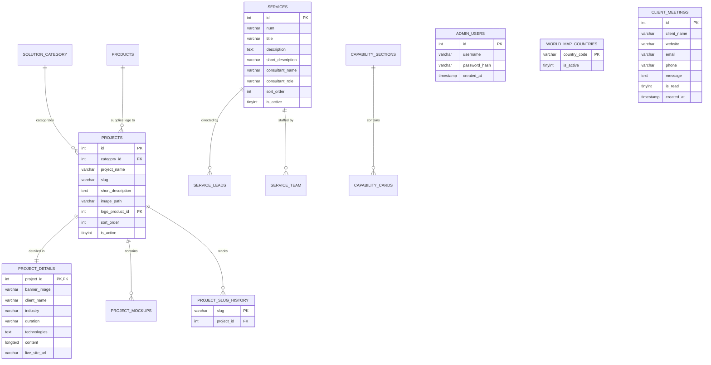

# Creative Web Technologies (CWT) Corporate Website

> A bespoke PHP/MySQL corporate marketing platform and custom Content Management System (CMS) for **Creative Web Technologies (CWT)** — an enterprise technology partner and offshore software engineering consultancy based in Sri Lanka. The site showcases CWT's core service offerings (Software Engineering, AI Engineering, Data Engineering, DevOps & Cloud, Project Delivery & PMO), enterprise digital solutions portfolio, client case studies, thought leadership insights, and executive crew directory to global corporate clients.

---

## 📦 Tech Stack

- **Backend Runtime:** PHP 8.1+ (uses PHP 8.0/8.1 union types `array|false`, `never` return types, and native functions like `str_contains()`, `str_starts_with()`, and `hash_equals()`)
- **Database:** MySQL 5.7+ / MariaDB 10.4+ via PHP Data Objects (`PDO`) with prepared statements and foreign key cascade constraints
- **Web Server:** Apache with `mod_rewrite` enabled (`.htaccess` for clean extensionless URLs and custom status error handling)
- **Frontend Core:** Vanilla HTML5, modern CSS3 (Custom Properties / CSS Variables, Grid, Flexbox, prefers-color-scheme tokens), and Vanilla JavaScript (ES6+)
- **Rich Text & Media:**
  - [Quill 1.3.6](https://quilljs.com/) (Snow theme rich text editor for project case studies and blog posts)
  - DOMDocument / libxml image extractor (decodes base64 inline images to disk before SQL persistence)
- **UI & Animation Libraries:**
  - [SweetAlert2 11.x](https://sweetalert2.github.io/) (bundled locally in `assets/js/sweetalert2.all.min.js` with CDN fallback for admin toasts and confirmation modals)
  - [particles.js 2.0.0](https://vincentgarreau.com/particles.js/) (CDN deferred loading for interactive footer particle mesh)
  - [Font Awesome 6.5.2](https://fontawesome.com/) (CDN icon font)
  - [Google Fonts](https://fonts.google.com/) (`Inter`, `Poppins`, `Exo 2`, `Dancing Script`)
- **Mapping:** Embedded TopoJSON / SVG vector world map backed by `includes/world-map-countries.json`

---

## 📁 Project Structure

```text
CWT Site/
├── .htaccess                   # Apache clean URLs, method filtering, and custom error document routing
├── about.php                   # Company history, vision & mission, leadership statistics
├── card.php                    # Static standalone HTML/CSS carousel prototype (test artifact)
├── clients-say.php             # Client testimonials and feedback stories
├── contact.php                 # Contact form, lead capture, and company office coordinates
├── error.php                   # Unified error routing handler for HTTP status codes (400-504)
├── index.php                   # Public homepage: hero, stats, client marquee, showcase, services
├── insight-detail.php          # Single blog / thought leadership article reader
├── insights.php                # Thought leadership articles and technology blog listing
├── our-crew.php                # Team directory: executive leadership and specialist crew
├── OurCrew-talk.php            # Standalone static CTA band prototype (test artifact)
├── privacy-policy.php          # Legal privacy policy statement
├── products.php                # Digital solutions catalog & interactive global reach map
├── project-detail.php          # In-depth project case study page with TOC and mockup carousel
├── README.md                   # Project documentation
├── service-talk.php            # Standalone static CTA band prototype (test artifact)
├── services.php                # Core services, technical capabilities, delivery workflow, tech stack
├── World-Map-Dots.svg          # High-resolution vector dot-matrix world map illustration
├── admin/                      # Restricted administrative control panel
│   ├── about.php               # Admin: Manage company stats, history paragraphs, vision & mission
│   ├── add-admin.php           # Admin: Provision new administrator accounts
│   ├── client-meeting.php      # Admin: View, mark read, and delete contact inquiries
│   ├── clients.php             # Admin: Add, toggle, reorder, and remove client partner logos
│   ├── crew.php                # Admin: Manage executive leadership and engineering crew
│   ├── dashboard.php           # Admin: System overview, metric counters, and quick actions
│   ├── feedback.php            # Admin: Manage client testimonials and reviewer photos
│   ├── footer.php              # Admin: Update footer copy, contact details, and social links
│   ├── home-showcase.php       # Admin: Manage homepage visual showcase cards and project links
│   ├── index.php               # Admin: Routing gateway (redirects to dashboard or login)
│   ├── industries.php          # Admin: Manage industry domains and icons
│   ├── insight-edit.php        # Admin: Create and edit blog articles with Quill & tags
│   ├── insights.php            # Admin: List, publish/unpublish, and delete blog posts
│   ├── layout_bottom.php       # Admin: Shared footer, SweetAlert2 flash triggers, sidebar JS
│   ├── layout_top.php          # Admin: Shared HTML head, navigation sidebar, topbar, flash alerts
│   ├── login.php               # Admin: Authentication portal with bcrypt verification
│   ├── logout.php              # Admin: Session revocation and logout redirect
│   ├── products.php            # Admin: Manage standalone product brands and external links
│   ├── project-edit.php        # Admin: Quill rich-text editor for project case studies & mockups
│   ├── services.php            # Admin: Manage services, delivery leads, and capability sections
│   ├── solution-category.php   # Admin: Manage solution groupings and display colors
│   ├── solution-projects.php   # Admin: Manage solution projects, slugs, and product logo associations
│   ├── tech-stack.php          # Admin: Manage technical tools & technologies by competency
│   └── world-map.php           # Admin: Toggle active client countries on the global map
├── assets/                     # Frontend static assets
│   ├── css/                    # Public stylesheets and admin-specific style sheets
│   ├── Images/                 # Static brand assets, vector graphics, and industry icons
│   ├── js/                     # Public scripts, admin modules, and vendor libraries
│   └── logos/                  # Official Creative Web Technologies logo variations
├── includes/                   # Shared backend utilities, layout partials, and data models
│   ├── auth.php                # Session guard helpers (`requireAuth`, `loginAdmin`, `logoutAdmin`)
│   ├── closing-cta.php         # Contextual call-to-action banner included across public pages
│   ├── db.php                  # PDO database singleton connection with error failover
│   ├── error-handlers.php      # Global exception & shutdown hooks to catch fatal errors cleanly
│   ├── error-page.php          # Zero-dependency standalone HTML error renderer for HTTP 4xx/5xx
│   ├── footer.php              # Shared public footer, particles canvas, and interaction scripts
│   ├── functions.php           # Global helper functions, CRUD wrappers, sanitization, image pipeline
│   ├── loader.php              # Legacy loading overlay stub (overlay intentionally decommissioned)
│   ├── navbar.php              # Shared public navigation bar, theme toggle, and mobile drawer
│   ├── project-content-images.php # Base64 Quill image parser and filesystem extractor
│   ├── theme.php               # Dynamic theme CSS/JS linker with cache-busting `filemtime`
│   ├── world-map.php           # World map country catalog decoder and active country filter
│   ├── world-map-countries.json # Geo-coordinate & polygon metadata catalog of world nations
│   └── world-map-countries.LICENSE.txt # MIT License for the world map data file
├── sql/                        # Database migration scripts
│   ├── 2026-10-28-project-url-history.sql      # Project slug redirection history schema
│   ├── 2026-10-29-project-product-logo.sql     # Projects table logo_product_id relationship
│   └── 2026-10-29-service-short-description.sql# Services table short_description addition
└── uploads/                    # Dynamic media storage (must be web-writable)
    ├── about/                  # Company history and about us imagery
    ├── clients/                # Client brand logos
    ├── Crew/                   # Team member profile headshots (note: uppercase 'C')
    ├── feedback/               # Testimonial client photos (created on upload)
    ├── industries/             # Industry sector icons and graphics
    ├── insights/               # Blog post featured banners and inline media
    ├── mockup/                 # Desktop/laptop project application screenshots
    ├── products/               # Product logos and brand marks
    ├── projects/               # Project case study cards, banner covers, and inline editor images
    ├── showcase/               # Homepage showcase preview cards
    └── tech/                   # Technology stack icons and logos
```

---

## 🚀 Local Setup (XAMPP)

### 1. Prerequisites
- **XAMPP** with **PHP 8.1+** and **MySQL 5.7+ / MariaDB 10.4+**.
- Apache `mod_rewrite` enabled in `httpd.conf` (enabled by default in standard XAMPP).

### 2. Codebase Placement
Clone or copy the project folder directly into your XAMPP web root:
```text
C:\xampp\htdocs\CWT Site
```
*(If you rename this folder, see [Configuration](#-configuration) below).*

### 3. Database Initialization
1. Start **Apache** and **MySQL** via the XAMPP Control Panel.
2. Open **phpMyAdmin** (`http://localhost/phpmyadmin`) or MySQL CLI.
3. Create the database:
   ```sql
   CREATE DATABASE IF NOT EXISTS `cwt_site_1` DEFAULT CHARACTER SET utf8mb4 COLLATE utf8mb4_unicode_ci;
   USE `cwt_site_1`;
   ```
4. Import the base database schema and seed data.
   > [!IMPORTANT]
   > The `sql/` directory contains only incremental updates. Import your base schema dump (`cwt_site_1.sql`) first if available. Then apply the migrations in strict chronological order:
   - `sql/2026-10-28-project-url-history.sql`
   - `sql/2026-10-29-project-product-logo.sql`
   - `sql/2026-10-29-service-short-description.sql`

### 4. Database Connection
Check `includes/db.php` and update credentials to match your local MySQL server if non-standard:
```php
define('DB_HOST', 'localhost');
define('DB_NAME', 'cwt_site_1');
define('DB_USER', 'root');
define('DB_PASS', '');
define('DB_CHARSET', 'utf8mb4');
```

### 5. Filesystem Permissions
Ensure the web server has full read/write permissions to the `uploads/` tree and all its subfolders:
- `uploads/about/`
- `uploads/clients/`
- `uploads/Crew/`
- `uploads/feedback/`
- `uploads/industries/`
- `uploads/insights/`
- `uploads/mockup/`
- `uploads/products/`
- `uploads/projects/`
- `uploads/showcase/`
- `uploads/tech/`

### 7. Accessing the Application
- **Public Website:** `http://localhost/CWT Site/` (or `http://localhost/CWT Site/index.php`)
- **Admin Control Panel:** `http://localhost/CWT Site/admin/` (or `http://localhost/CWT Site/admin/login.php`)

---

## 🔐 Admin Panel

Access requires authentication (`$_SESSION['admin_logged_in'] === true`). The panel provides full content lifecycle management:

| Concern | Admin File | Description |
| :--- | :--- | :--- |
| **Auth** | `admin/login.php` | Secure administrator login authenticating against `admin_users` via bcrypt. |
| **Auth** | `admin/logout.php` | Destroys admin session, expires session cookies, and redirects to login with flash notice. |
| **Admins** | `admin/add-admin.php` | Provision new administrator accounts with username validation, strength checking, and CSRF protection. |
| **Overview** | `admin/dashboard.php` | System health dashboard displaying real-time content counts, unread meeting badges, and quick links. |
| **Content** | `admin/about.php` | Update core company metrics (years, retention, team count), 3-part history text, and vision/mission statements. |
| **Services** | `admin/services.php` | Manage services (number, title, short/long description, consultant) and technical capability accordion cards. |
| **Products** | `admin/products.php` | CRUD management for standalone product software logos, external landing links, and descriptions. |
| **Industries** | `admin/industries.php` | Manage industry domain tags, order weighting, and industry icons. |
| **Insights** | `admin/insights.php` | Blog index to view posts, toggle published/draft visibility, and delete articles with image cleanup. |
| **Insights** | `admin/insight-edit.php` | Quill rich text editor to write articles, auto-generate URL slugs, assign comma-separated hashtags, and upload banners. |
| **Home Showcase**| `admin/home-showcase.php`| Configure homepage showcase grid items grouped by section with optional links to case studies. |
| **Tech Stack** | `admin/tech-stack.php` | Manage technology tool logos organized across 5 predefined competency categories. |
| **World Map** | `admin/world-map.php` | Multi-select and real-time AJAX toggle of active client countries rendered on the public SVG map. |
| **Footer** | `admin/footer.php` | Update global company contact email, phone, location address, about snippet, and social URLs. |
| **Solutions** | `admin/solution-category.php`| Manage solution categories, visual color themes, icons, and slug identifiers. |
| **Projects** | `admin/solution-projects.php`| Manage project names, short summaries, associated product logos, and automatic slug history tracking. |
| **Projects** | `admin/project-edit.php` | Full case-study authoring with Quill, live site URLs, cover banner, and multi-file mockup uploader. |
| **Clients** | `admin/clients.php` | Manage client partner logos, sort order, and homepage marquee visibility. |
| **Meetings** | `admin/client-meeting.php` | Review incoming contact inquiries, toggle read status, and securely delete submissions with admin password confirmation. |
| **Feedback** | `admin/feedback.php` | Manage customer testimonials, ratings, dates, and reviewer profile photos. |

---

## 🌐 Public Pages

| Route / File | What It Renders | Backing Data Sources & Includes |
| :--- | :--- | :--- |
| `index.php` | Public homepage with hero typography, animated experience metrics, client logo marquee, showcase grids, filtered service tabs, and value pillars. | `getClients()`, `getAboutUs()`, `getHomeShowcase()`, `services`, `includes/navbar.php`, `includes/footer.php`, `includes/theme.php`. |
| `services.php` | Detailed services breakdown, delivery lead consultants, interactive capability tabs, 6-stage delivery process, industry grid, and tech stack tabs. | `getClients()`, `getIndustries()`, `getTechStack()`, `getServiceSections()`, `getCapabilitySections()`, `includes/world-map.php`. |
| `about.php` | Company origin story, experience counters, historical milestones with side-by-side photography, and vision/mission cards. | `getAboutUs()`, `getHistory()`, `getVisionMission()`, `includes/closing-cta.php`. |
| `our-crew.php` | Executive leadership profile (CEO), senior expert consultants with education/experience details, and 3-column specialist team roster. | `getCrewByType($pdo, 'Expert')`, `getCrewByType($pdo, 'Team')`, `includes/closing-cta.php`. |
| `products.php` | Digital solutions catalog sorted by project count, with product branding, client badges, and an interactive global client footprint map. | `getSolutionCategories()`, `getProjectsByCategory()`, `getClients()`, `worldMapSelected()`. |
| `project-detail.php` | In-depth case study reader featuring responsive banner, automatic heading-based table of contents, Quill content body, live URL button, and 3-second auto-cycling laptop mockup carousel. | `getProjectWithDetails()`, `project_slug_history`, `getProjectMockupUrls()`, related projects query. |
| `clients-say.php` | Grid of client testimonials, corporate feedback quotes, reviewer portraits, and dates. | `getClientFeedback()`, `includes/closing-cta.php`. |
| `insights.php` | Thought leadership hub listing published articles, topics, estimated read times, and tags. | `getPublishedBlogs()`, `includes/closing-cta.php`. |
| `insight-detail.php` | Single article reader displaying hero banner, author/date metadata, formatted block/HTML content, tag pills, and word count calculation. | `getBlogBySlug()`, `includes/closing-cta.php`. |
| `contact.php` | Inbound project lead inquiry form with both standard POST and AJAX JSON submission modes, company address, phone, and direct email. | Inserts into `client_meetings`; reads `footer` table for company contact details. |
| `privacy-policy.php` | Comprehensive privacy policy, data protection terms, cookie disclosures, and compliance info. | Static legal content with dynamic `includes/navbar.php`, `includes/footer.php`. |
| `error.php` | Custom HTTP error landing screen supporting status codes 400 through 504. | `includes/error-page.php` via `renderSiteError()` (database-independent). |
| `card.php` | Standalone UI experiment for a horizontal hover-reveal image track. | Static mockup (unlinked prototype). |
| `OurCrew-talk.php` | Standalone UI experiment for call-to-action banner styling. | Static mockup (unlinked prototype). |
| `service-talk.php` | Standalone UI experiment for call-to-action banner styling. | Static mockup (unlinked prototype). |

---

## 🗄️ Database

Inferred database architecture based on SQL migrations, `includes/functions.php`, and admin CRUD operations:



### Table Reference
- `admin_users`: Administrator credentials (`id`, `username`, `password_hash`, `created_at`).
- `aboutus`: Company statistics (`start_year`, `retention_pct`, `employed_count`, `projects_count`).
- `history`: Company journey narrative (`para1`, `para2`, `para3`, `image1_path`, `image2_path`).
- `vision_mission`: Strategic statements (`vision_title`, `vision_para`, `mission_title`, `mission_para`).
- `clients`: Client logo marquee items (`company_name`, `logo_path`, `sort_order`, `is_active`).
- `client_feedback`: Testimonials (`client_name`, `feedback`, `feedback_date`, `photo_path`, `is_active`).
- `client_meetings`: Contact form submissions (`client_name`, `website`, `email`, `phone`, `message`, `is_read`, `created_at`).
- `products`: Product brands (`product_name`, `description`, `visit_url`, `show_button`, `sort_order`, `logo_path`).
- `solution_category`: Portfolio groupings (`name`, `description`, `color`, `icon`, `area_slug`, `sort_order`, `is_active`).
- `projects`: Individual case studies linked to a category and optional product logo (`category_id`, `project_name`, `slug`, `short_description`, `image_path`, `logo_product_id`, `sort_order`, `is_active`).
- `project_details`: 1-to-1 extended case study content (`project_id`, `banner_image`, `client_name`, `industry`, `duration`, `technologies`, `content`, `live_site_url`).
- `project_mockups`: Multi-image device mockups for project carousel (`project_id`, `image_path`, `sort_order`).
- `project_slug_history`: Historic URL slugs preserved to prevent broken links on project name updates (`slug`, `project_id`).
- `services`: Services (`num`, `title`, `description`, `short_description`, `consultant_name`, `consultant_role`, `sort_order`, `is_active`).
- `service_leads` & `service_team`: Personnel associated with a service (`service_id`, `name`, `sort_order`).
- `capability_sections`: Capability groupings (`slug`, `label`, `icon`, `accent`, `accent2`, `soft`, `sort_order`, `is_active`).
- `capability_cards`: Cards under a capability section (`section_id`, `title`, `icon`, `description`, `sort_order`).
- `industries`: Industry domains (`name`, `image_path`, `sort_order`).
- `tech_stack`: Technologies grouped by category (`name`, `category`, `logo_path`, `sort_order`).
- `crew`: Team profiles (`name`, `position`, `linkedin_url`, `crew_type`, `intern`, `sort_order`, `educational_qualification`, `domestic_experience`, `international_experience`, `profile_photo`).
- `world_map_countries`: ISO country codes toggled on the map (`country_code`, `is_active`).
- `home_showcase`: Homepage cards (`section_name`, `project_slug`, `image_path`, `sort_order`, `is_active`).
- `blog_details`: Blog posts (`topic`, `slug`, `content`, `hashtags`, `featured_image`, `publish_date`, `is_published`).
- `footer`: Company coordinates and links (`para`, `linkedin_url`, `facebook_url`, `youtube_url`, `instagram_url`, `email`, `phone`, `address`, `theme`).

---

## 🎨 Assets & Uploads

### Public vs Admin Assets
- **Public Styles & Scripts:** Modern design system built upon `modern.css` (variables, typography, light/dark mode definitions) and `design.css` (shared structural utilities). Page-specific modules load alongside shared interactions (`interactions.js`, `navy-art.js`, `theme.js`).
- **Admin Styles & Scripts:** Unified administrative styles prefixed with `admin-*.css` and `admin-*.js`. Form enhancements include dynamic hashtag pill management, password strength meters, and SweetAlert2 toast integration (`admin-sweetalert.js`).

### Upload Directory Layout
All uploaded user media is routed through `uploadFile()` in `includes/functions.php`:
- `uploads/about/` — About page company photos
- `uploads/clients/` — Client partner corporate logos
- `uploads/Crew/` — Executive and crew member headshots
- `uploads/feedback/` — Client testimonial reviewer photos
- `uploads/industries/` — Industry domain icons/photos
- `uploads/insights/` — Blog article header banners and inline photos
- `uploads/mockup/` — Project software screenshot mockups
- `uploads/products/` — Product brand logos
- `uploads/projects/` — Project thumbnail cards, wide banner images, and Quill inline media (`inline-<sha256>.<ext>`)
- `uploads/showcase/` — Homepage showcase tiles
- `uploads/tech/` — Programming language and tool logos

### Filename Conventions & Security
- Standard uploads: `uniqid('cwt_', true) . '.' . $ext` (e.g. `cwt_6ae48969213d34.00567918.jpg`).
- Inline Quill images: `'inline-' . hash('sha256', $bytes) . '.' . $ext` stored in `uploads/projects/`.
- File validation enforces:
  - Allowed extensions: `jpg`, `png`, `gif`, `webp`, `svg`.
  - Max upload size: 5 MB (checked before decoding base64 or moving temp files).
  - MIME-type inspection via `finfo(FILEINFO_MIME_TYPE)`.
  - Directory traversal prevention with `realpath()` and boundary verification within `UPLOAD_DIR`.
  - Reference checking (`isImageReferencedElsewhere`) before deleting unlinked files from disk.

---

## ⚙️ Configuration

Application configuration is declared in `includes/functions.php` and `includes/db.php`:

| Constant / Setting | Current Value | Description / Security Note |
| :--- | :--- | :--- |
| `DB_HOST` | `'localhost'` | MySQL host. |
| `DB_NAME` | `'cwt_site_1'` | Database name. |
| `DB_USER` | `'root'` | Database user. |
| `DB_PASS` | `''` | Database password. *(Flag: should be moved to environment variables).* |
| `SITE_URL` | `'http://localhost/CWT Site'` | Base application URL. *(Flag: hardcodes protocol, host, and subdirectory name; breaks under custom virtual hosts or HTTPS unless modified).* |
| `ADMIN_URL` | `SITE_URL . '/admin'` | Base admin panel URL. |
| `UPLOAD_DIR` | `__DIR__ . '/../uploads/'` | Absolute filesystem path for uploaded files. |
| `UPLOAD_URL` | `SITE_URL . '/uploads/'` | Web-accessible URL path for uploaded files. |

### Session Keys
- `$_SESSION['admin_logged_in']` (bool): Admin authentication flag.
- `$_SESSION['admin_username']` (string): Username of currently authenticated admin.
- `$_SESSION['csrf_token']` (string): 64-character hex token generated via `random_bytes(32)`.
- `$_SESSION['cwt_flash']` / `$_SESSION['flash_success']` / `$_SESSION['flash_error']`: Temporary flash alerts consumed by `layout_bottom.php`.

---

## 🧪 Known Issues / TODOs

- [ ] **Missing Baseline Database Dump:** The repository contains only 3 incremental SQL migrations in `sql/`. A complete initial schema file (`schema.sql`) should be generated and committed so new developers can initialize the database without reverse-engineering tables.
- [ ] **Hardcoded Base URL & Environment Config:** `SITE_URL` is hardcoded as `'http://localhost/CWT Site'` in `includes/functions.php`, and database credentials in `includes/db.php` lack `.env` support. Moving configuration to a `.env` loader or `config.php` will allow smooth deployment across local virtual hosts, Docker, and staging/production domains.
- [ ] **Constant Re-declaration Notice:** `admin/index.php` contains an unconditional `define('ADMIN_URL', ...)` while `includes/functions.php` already defines it, which emits a PHP notice (`Notice: Constant ADMIN_URL already defined`). It should be guarded with `if (!defined('ADMIN_URL'))`.
- [ ] **Inconsistent CSRF Protection Across Admin Forms:** While `admin/add-admin.php`, `admin/crew.php`, `admin/services.php`, and `admin/world-map.php` enforce `verifyCsrf()`, other admin endpoints (`admin/footer.php`, `admin/about.php`, `admin/clients.php`, `admin/feedback.php`, `admin/industries.php`, `admin/insight-edit.php`, `admin/products.php`, `admin/solution-category.php`, `admin/solution-projects.php`, `admin/tech-stack.php`) and `admin/login.php` do not validate CSRF tokens on POST submissions.
- [ ] **Public Contact Form Rate Limiting / CAPTCHA:** `contact.php` accepts POST submissions directly into `client_meetings` without CSRF tokens, honeypot fields, or CAPTCHA validation, making it vulnerable to automated spam.
- [ ] **Case Sensitivity in Folder Names:** The crew upload folder is named `uploads/Crew/` with an uppercase `C`, whereas all other upload folders are lowercase (`about`, `clients`, `industries`, etc.). On case-sensitive Linux servers, mismatched path casing can lead to 404 image errors.
- [ ] **Inconsistent Routing Links in UI:** `includes/navbar.php` links to `contact` without extension on desktop (`SITE_URL . '/contact'`), but uses `contact.php` in mobile navigation (`SITE_URL . '/contact.php'`). Standardizing on clean extensionless URLs across all templates is recommended.
- [ ] **Dead Prototype Files:** `card.php`, `OurCrew-talk.php`, and `service-talk.php` are standalone design mocks disconnected from the application framework. They should be archived to a `docs/` or `design/` folder or removed.
- [ ] **Decommissioned Loader Include:** `includes/loader.php` is an empty stub after the loading animation was decommissioned in commit `415c33a`. Residual `require` statements can be cleaned up.

---

## 📝 License / Author

- **Author / Development Team:** Creative Software / Creative Web Technologies (CWT) Engineering Team
  - Commit history contributors: `R. Abishigan <trincoabishigan@gmail.com>`, `LehanCWT <lehan@creativesoftware.com>`.
- **Copyright:** © 2026 Creative Web Technologies. All Rights Reserved.
- **License:** Proprietary. Not specified for public distribution or open-source reuse. Included third-party datasets (`includes/world-map-countries.json`) are licensed under their respective terms (see `includes/world-map-countries.LICENSE.txt`).
